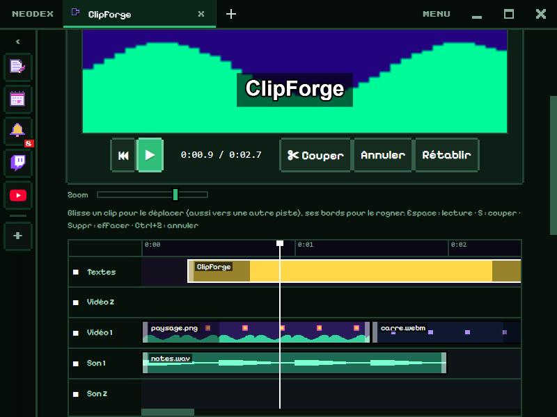

# ClipForge

NeoDex's video editor: a multi-track timeline, transitions, texts, effects, and video export.

*Version française : [README.md](README.md)*

## Editing

- **Import** videos, images and sounds (or drop them on ClipForge), then click a media to place it at the end of its track.
- **Five tracks**:
  - **Texts**, on top of everything;
  - **Video 2**, on top of Video 1 (for picture-in-picture, shrink it);
  - **Video 1**;
  - **Sound 1** and **Sound 2**, for music and sound effects.
- **Dragging a clip** moves it, also to another track of the same kind. **Dragging its edges** trims it. Clips snap to the start, to the playhead and to the edges of other clips.
- **Cut** (S) cuts the selected clip under the playhead, or every clip under it if none is selected.
- The square in front of each track mutes or restores it.
- **Undo** and **Redo** (Ctrl+Z, Ctrl+Y) go back over every change.

## Clip settings

Click a clip to open its settings:

- **entry**: fade, slide, zoom or wipe, with its duration, and a **fade-out**;
- **size**, **position** and **fill the frame** for images and videos;
- **effects**: brightness, contrast, saturation, black and white, sepia, hue, blur, pixels, and one-click looks (Black and white, Old, Vivid, Cold, Night, Retro pixel);
- **speed** from ×0.25 to ×4 and **volume** up to 200% for videos and sounds;
- **texts**: several lines, font, colour, size, dark background.

## Export

Choose the **format** (landscape 16:9, portrait 9:16 or square 1:1), then **Export as WebM**. The edit is filmed in real time with its sounds mixed: keep ClipForge open until the end. The video goes to your Downloads.

## Controls

| Key | Action |
|---|---|
| Space | play / pause |
| S | cut under the playhead |
| Delete | delete the selected clip |
| ← → | previous / next frame |
| Home | back to the start |
| Ctrl+Z / Ctrl+Y | undo / redo |

## Data

The edit is kept in the plugin folder, with media of 15 MB or less. A bigger media stays in the list but must be chosen again the next time ClipForge opens (it is marked "To re-import"). Permission: `storage` only.

The text recipes and templates of the old version of ClipForge are no longer used; they stay in the plugin folder.
