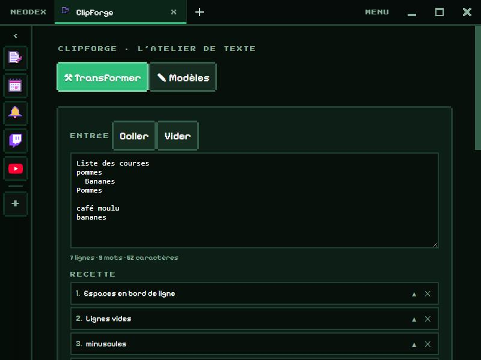

# ClipForge

L'atelier de texte : des étapes empilées qui transforment ton texte en direct, et des modèles à trous.

*English version: [README.en.md](README.en.md)*

## Transformer

À gauche le texte d'entrée, au milieu la recette, à droite le résultat, mis à jour à chaque touche. Une recette est une suite d'étapes appliquées dans l'ordre :

- **casse** : MAJUSCULES, minuscules, Chaque Mot, début de phrase, camelCase, PascalCase, snake_case, kebab-case, CONSTANTE, slug d'URL, sans accents ;
- **lignes** : espaces en bord de ligne ou en double, lignes vides, lignes en double, trier (A → Z avec les nombres dans le bon ordre, ou par longueur), inverser, numéroter, garder ou retirer les lignes qui contiennent un texte ;
- **chercher** : remplacer, extraire, couper en lignes, joindre les lignes, entourer chaque ligne. Écris `/motif/` pour une expression régulière (`$1` dans le remplacement, `\n` pour un retour à la ligne) ;
- **encodages** : Base64 (accents et émojis compris), URL, HTML, JSON indenté ou compact.

Une étape qui échoue (un JSON mal formé par exemple) s'encadre en rose avec l'erreur. Les recettes se gardent sous un nom pour être rejouées. **Reprendre en entrée** repart du résultat, **↓ .txt** l'enregistre.

## Modèles

Des textes à trous : écris `{nom}`, `{sujet}`… et un champ apparaît pour chacun. `{date}`, `{heure}` et `{jour}` se remplissent tout seuls. Trois modèles pour commencer (relance par mail, rapport de bug, compte rendu).

L'historique de ce que tu copies est dans un autre plugin : **Presse-papiers**.

## Données

Le texte en cours, les recettes et les modèles sont gardés dans le dossier du plugin. Autorisation : `storage` seulement (le bouton **Coller** demande l'accès au presse-papiers ; sinon, Ctrl+V).
