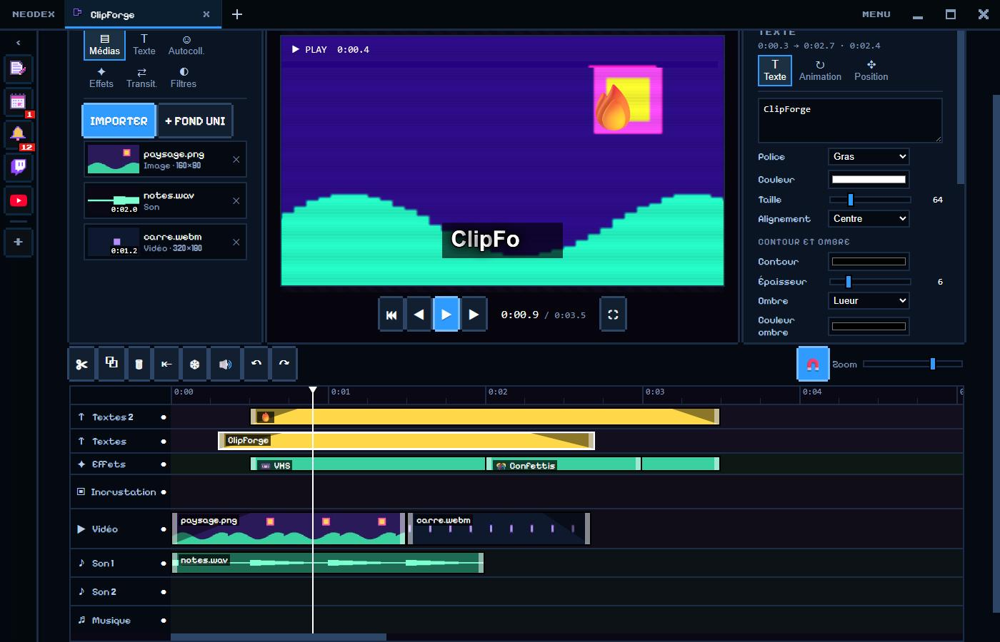

# ClipForge

Le monteur vidéo de NeoDex, dans l'esprit de CapCut : une timeline à 8 pistes, 13 transitions, des textes stylés et animés, des autocollants, 16 effets, 14 filtres, et l'export en vidéo.

*English version: [README.en.md](README.en.md)*

## Sous-titres (nouveau en 3.1.0)

Caler un texte au clavier (Entrée à la fin de chaque phrase), importer et exporter des sous-titres SRT ou VTT, animation Karaoké qui éclaire chaque mot, raccourcis J, K, L, I et O.

## La bibliothèque (à gauche)

- **Médias** : importer des vidéos, des images et des sons (ou les glisser sur ClipForge), ajouter un **fond uni** ; un clic pose le média au bout de sa piste.
- **Texte** : un texte simple ou un des 10 styles tout prêts (Sous-titre, Titre, Contour, Néon, Bulle, Rétro, Machine, Étiquette…).
- **Autocollants** : 40 émojis qui se posent à la tête de lecture.
- **Effets** : vignette, grain, VHS, glitch, flash, secousse, zoom pulsé, bandes cinéma, noir et blanc, flou, pixels, neige, confettis, pluie, étoiles, cœurs. Ils s'appliquent à toute l'image sous eux.
- **Transitions** : 13 entrées et sorties (fondu, glisse, monte, descend, zoom, dézoom, volet, cercle, flou, flash, tourne, glitch) pour le clip choisi.
- **Filtres** : 14 looks avec leur aperçu sur ton clip.

## Les pistes

Textes 2, Textes, Effets, Incrustation (par-dessus la vidéo), Vidéo, Son 1, Son 2 et Musique. Les vidéos montrent leur pellicule, les sons leur forme d'onde.

- **Glisser un clip** le déplace, aussi vers une autre piste du même genre ; **glisser ses bords** le rogne. L'aimant 🧲 colle les clips au début, à la tête de lecture et aux bords des autres.
- Outils : **couper**, **dupliquer**, **supprimer**, **supprimer en refermant le trou**, **figer l'image** (2 s), **détacher le son** d'une vidéo, annuler, rétablir.
- Le point devant chaque piste la coupe ou la remet.

## Régler un clip (à droite)

- **Image** : taille, position, rotation, opacité, remplir le cadre, **fond flou**, miroirs.
- **Animation** : transition d'entrée et de sortie avec leur durée, et un mouvement pendant le clip (zoom lent, dézoom, panoramique, secousse, pulsation, rotation, flottement).
- **Couleur** : les looks et 8 réglages (luminosité, contraste, saturation, noir et blanc, sépia, teinte, flou, pixels).
- **Son** : vitesse de ×0,1 à ×8, volume jusqu'à 200 %, fondus.
- **Texte** : 8 polices, couleur, taille, alignement, contour, ombre (portée, douce, lueur), fond (bande ou bulle) et animation (machine à écrire, mot par mot, pop, rebond, vague, battement).

## Sous-titres (3.1.0)

Dans l’onglet Texte :

- **Caler un texte** : colle ce qui est dit dans la vidéo, la lecture démarre, et tu appuies sur Entrée à la fin de chaque phrase. Chaque phrase devient un sous-titre à la bonne place.
- **Importer SRT/VTT** : un fichier de sous-titres (fait par Whisper, YouTube ou un autre outil) se pose sur la piste Textes ; tu peux aussi le glisser dans la fenêtre.
- **Exporter SRT** : tous les textes du montage, en fichier .srt.
- L’animation **Karaoké** éclaire chaque mot à son tour, sur toute la durée du texte.

## Exporter

Sans clip choisi, le panneau de droite règle le projet : **format** (16:9, 9:16, 1:1, 4:5, 4:3, 21:9), couleur du fond, **qualité** (480p, 720p, 1080p), **images par seconde** (24, 30, 60) et **fichier** (WebM, ou MP4 quand l'enregistreur le permet). **Image PNG** enregistre l'image sous la tête de lecture. L'export filme le montage en temps réel avec ses sons mixés : garde ClipForge ouvert jusqu'au bout.

## Commandes

| Touche | Action |
|---|---|
| Espace | lecture / pause |
| J / K / L | reculer d’une seconde (Maj : cinq) / pause / lecture |
| I / O | le clip choisi commence / finit à la tête de lecture |
| Entrée / Échap | pendant le calage des sous-titres : fin de la phrase / arrêter |
| S | couper sous la tête de lecture |
| Suppr / Maj+Suppr | supprimer / supprimer en refermant le trou |
| Ctrl+C / Ctrl+V | copier / coller le clip à la tête de lecture |
| Ctrl+D | dupliquer |
| ← → | image précédente / suivante |
| Origine | revenir au début |
| Ctrl+Z / Ctrl+Y | annuler / rétablir |

## Données

Le montage est gardé dans le dossier du plugin, avec les médias de 15 Mo au plus. Un média plus gros reste dans la liste mais il faut le choisir à nouveau à la prochaine ouverture (il est marqué « À réimporter »). Les montages des versions d'avant s'ouvrent tels quels. Autorisation : `storage` seulement.

## Taille de l’écran (3.0.1)

Les trois colonnes (médias, aperçu, réglages) et la hauteur de l’aperçu suivent la taille de la fenêtre : sur un petit portable, la timeline reste visible sous l’aperçu ; sur un grand écran, ClipForge prend toute la largeur. Les petits textes sont plus grands.
